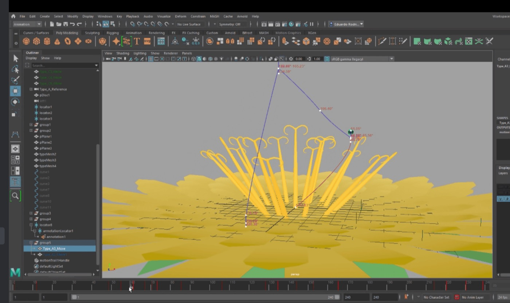
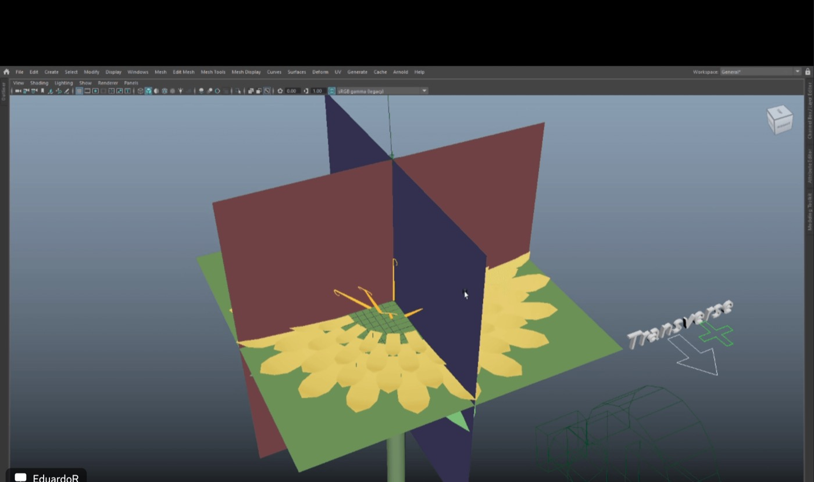

Meeting with Eduardo and Noora. Three choreography traces, each duplicated across 10 angles and seen from above, produced a striking, origami-like pattern: pollen types A3, B1 and C1, with correct height, speed and duration.

Trajectories are a trade-off between the overall vision, Noora's inspiration and Eduardo's interpretation. After Noora's work with the dancers, Eduardo could draft shapes from the demo videos, but things only unfolded organically when the two worked directly together.

The hard part was movement with vitality and character that is visible from the bee's perspective, can be linked with sound, and moves at a speed that is perceivable and enjoyable.
