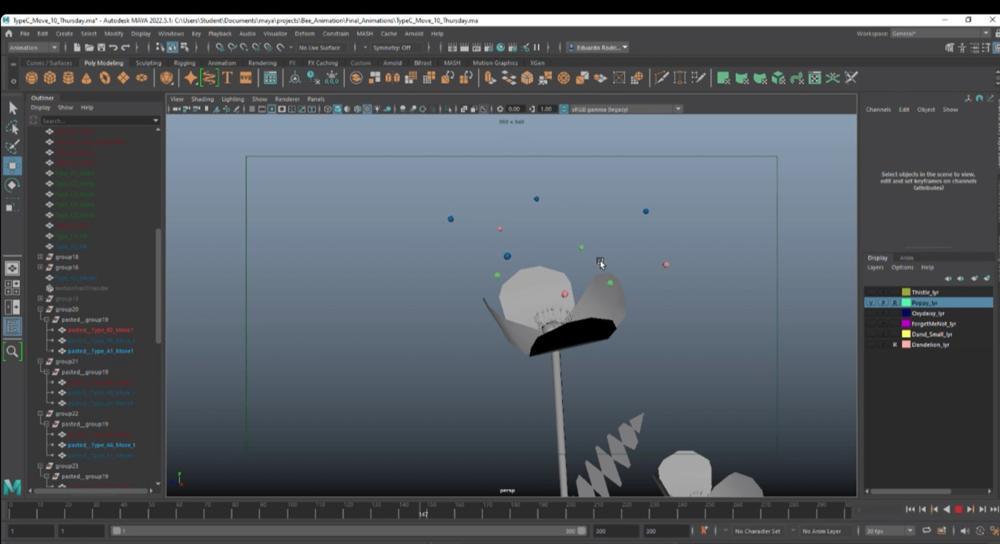
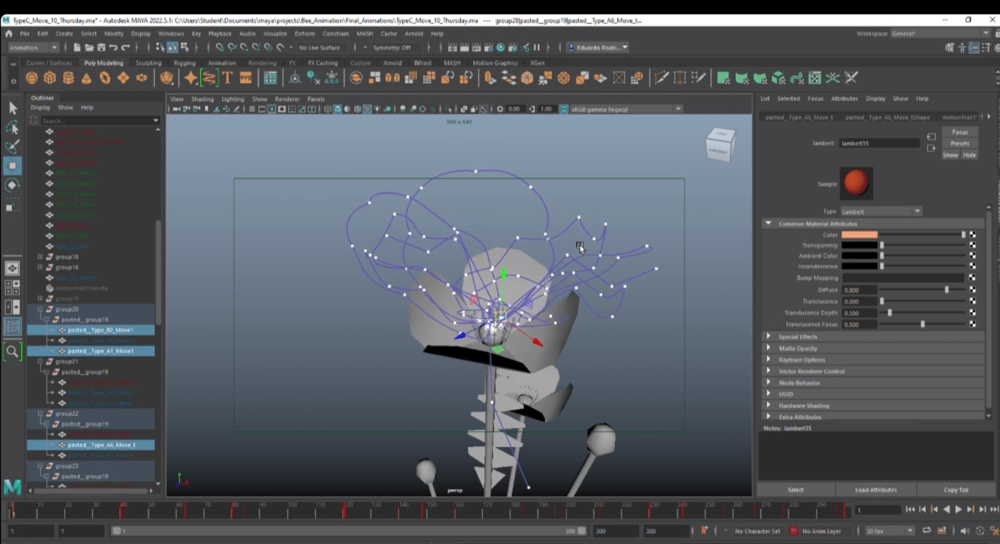
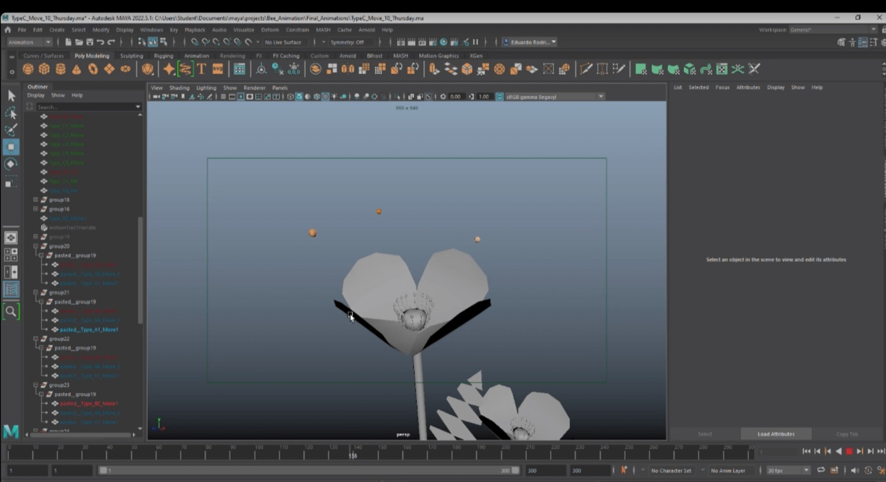
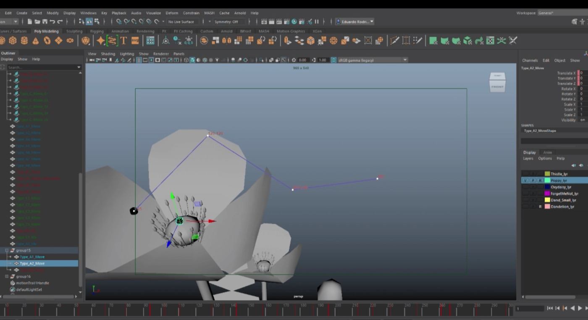
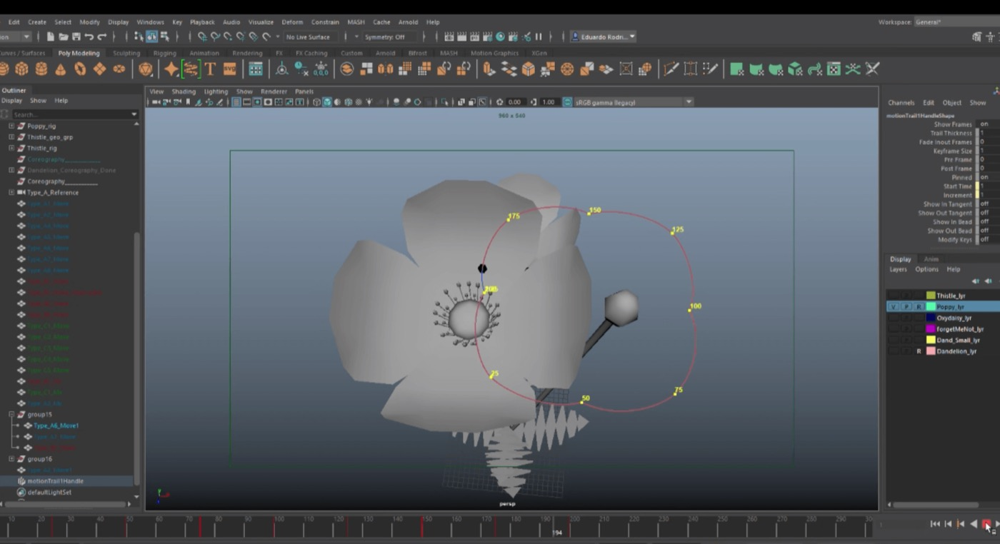
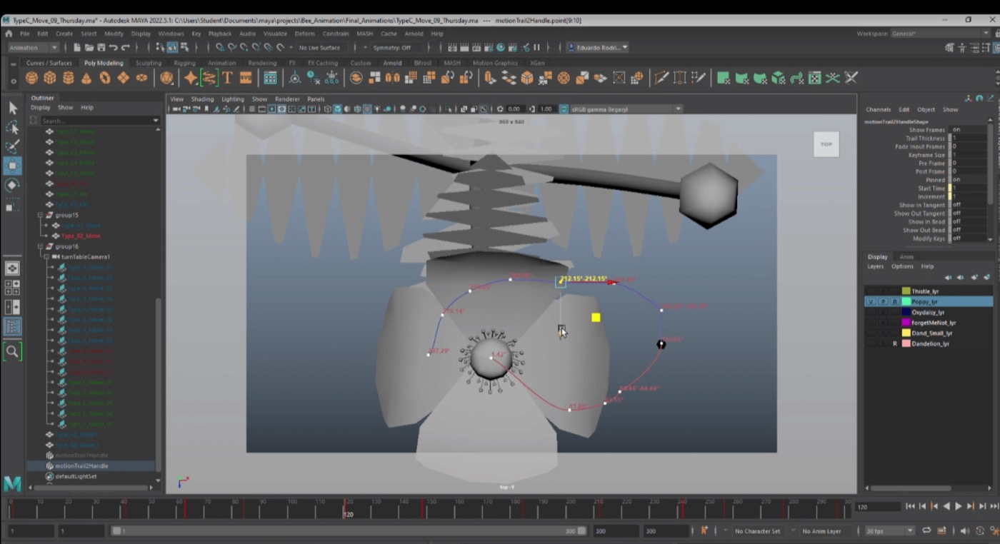
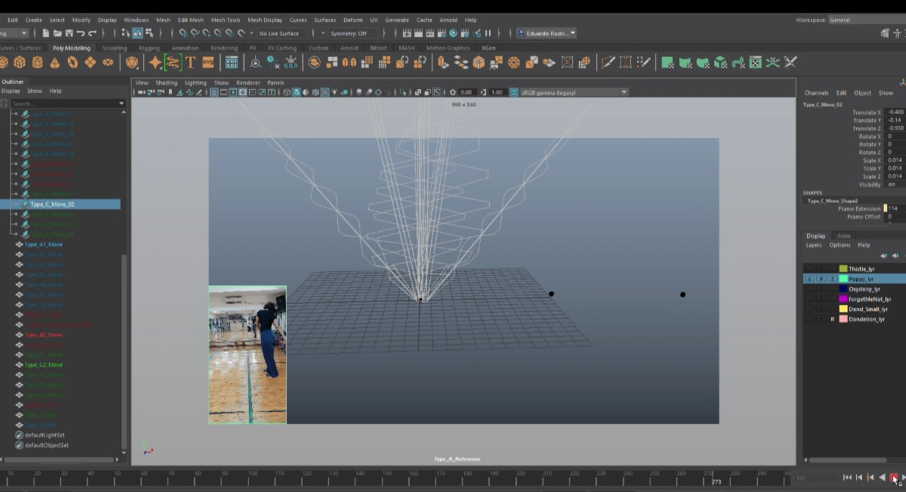

Discussion with Kush and Eduardo, then a meeting with Eduardo and Noora.

We discussed randomness in relation to the total number of pollen and the whole choreographic pattern. Pollen types and rotations are now chosen at random, but could be guided by Noora's decisions (for example, maximum rotation limits per type). We also discussed colour per type and colour gradients, which carry weight in the audiovisual result.

## The poppy

We worked on three new trajectories for the poppy. We began with the forget-me-not, where Noora proposed grouping its nine flowers to create group movement rather than pollen always emerging from the centre, but time was short, so we moved to the poppy. Choreographies A1, A6 and B2 were chosen.

*First poppy trajectory (10 seconds).*

*Second poppy trajectory.*

*Third poppy trajectory in progress. Reversing the original path wasn't anticipated in rehearsal, so it was improvised in Maya following the line drawn over the dancer's video.*

## From Maya to Unity

Much of the day went into the translation from Maya trajectories to Unity. Unity's units affect the speed and scale of each trajectory, as do the original flower sizes and how they are scaled in the game, so these need to be synchronised before the pipeline work starts. Food for thought for next time; for the prototype it works.

*Eduardo tracing a trajectory in Maya from Noora's videos, where the dancer is the pollen.*
