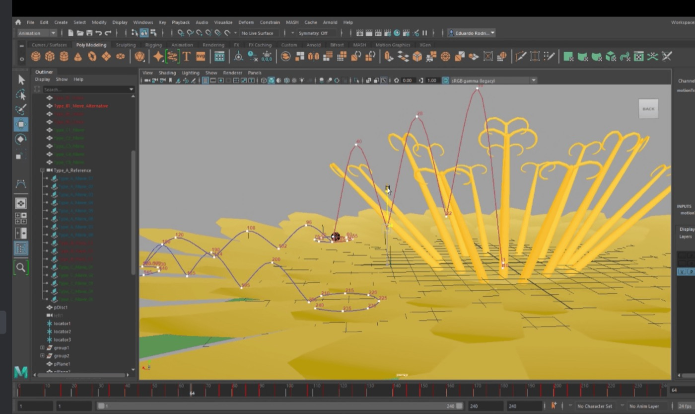

Write the post in short paragraphs. Start with what happened or what you noticed, in plain words, then go deeper.

## Citing sources

Cite in the text in author–date style, for example: a player becomes "the protagonist, the decision maker" (Burgun 2015), and list the full entries in the **References** field. They appear numbered at the end of the post.

For side comments, use a footnote: type `[^1]` where the note goes, and the note text at the bottom of the post as `[^1]: The note.` Footnotes need the editor's Markdown mode (the switch in the editor toolbar).[^1]

## Images, audio and video

Upload images with the image button. Write a caption in italics directly under the image:

*Figure 1. Pollen trajectories repeated at ten angles (Song of the Bees, 2024).*

To embed a YouTube video, switch to Markdown mode and paste the embed code from YouTube's Share → Embed.

> Use a quote block for longer quotations or for key questions.

[^1]: This is a footnote. It is listed at the bottom of the post with a link back to the text.
